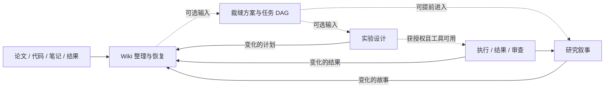

# Tailor Wiki · Research Skills

> **From Research Materials to Evidence-backed Stories**
> 基于 [DSH Paper Tailor](https://github.com/ZyfNO2/dsh-paper-tailor) 的轻量科研技能包：把论文、笔记和实验记录整理为可追溯的知识，接着做方法裁缝、实验设计与研究叙事。

**技能包优先更新，DSH 插件随后同步。** 五个 Skill 可独立使用，不需要总 Skill 或完整工作台。Team 为后续占位，插件与技能包分别验收、发布。

[安装与使用](#-quick-start) · [五个技能](#-从哪个入口开始) · [工作台展示](#-showcase--研究工作台) · [验证记录](docs/VERIFICATION.md)

> 📷 **工作台总览展示占位**
> 待新版 UI 合并并验收后，补充真实截图与演示。以下展示位置用于说明产品结构，不代表全部功能已经实现。

## 🎯 What is Tailor Wiki?

研究通常已经进行了一半：手里有论文、有代码、有几次实验，也有尚未解释清楚的结果。Tailor Wiki 希望让 Agent 接着这些材料推进，让每一步的来源、方案、结果和下一步都能找回来。

我们的主线是：**围绕研究目标提取相关、可比较的实验数据，再讲清楚为什么做、遇到什么问题、怎样解决、数据支持什么。**

1. **Understand：** 整理已有材料，建立有原文出处、版本和问题记录的 Wiki。
2. **Tailor：** 找到合适的基线与模块，说明方法怎样组合、为什么值得验证。
3. **Experiment：** 将问题转成对比、消融、预算与结果记录，接续已有实验。
4. **Tell & Maintain：** 根据证据组织简洁故事，并把实验与故事的新产物增量整理回 Wiki。

故事先给人读懂的解释，再展开证据与审查细节。筛选数据依据研究问题和可比条件，保留相关负结果；没有实验数据时，也可以先组织待验证的设计故事。

## 🧭 从哪个入口开始？

| 简短意图 | Skill | 用途 | 主要交付 |
| --- | --- | --- | --- |
| `/init` | `wiki-maintain` | 整理材料、恢复进度、增量维护 Wiki | Wiki、引用、覆盖清单与问题 |
| `/tailor` | `academic-tailor` | 拆解基线 A 与模块 b/c，提出方法组合 | `TAILOR.md`、研究任务 DAG |
| `/exp` | `experiment-design` | 安排对比、消融、指标、预算及记录 | `EXPERIMENT-PLAN.md`，关联已有或获授权执行的 Run |
| `/guide` | `research-guide` | 围绕研究问题学习论文与代码，按需讲解和练习 | `RESEARCH-GUIDE.md`；按需保存练习 |
| `/story` | `research-story` | 组织问题、方法、贡献、证据与局限 | `STORY-PLAN.md`、贡献—证据表 |

**软依赖，按需进入。** 可以跳过 Wiki 直接做裁缝，设计完成后先讲故事，也可以带着已有实验结果进入 `/exp`。创新假设包含在裁缝方案中，不再增加一个独立创新点 Skill。

短意图不表示所有宿主已注册斜杠命令；宿主未识别或内置 `/init` 冲突时，使用完整 Skill 名或自然语言即可。详见 [入口与宿主发现边界](research-pack/ENTRYPOINTS.md)。

### 三个最短使用示例

**已有资料，接着整理**

```text
用 wiki-maintain 整理这个目录。先盘点全部材料，复用已有 Wiki，
只更新变化和未完成部分，保留原文出处、人工笔记与待核实项。
```

没有材料时，先确认研究目标与是否需要联网寻找资料；不凭空生成研究知识。

**选一个值得验证的组合**

```text
用 academic-tailor 看看这些论文和已有基线，给我一个有依据的组合方案，
说明怎么接、缺什么，并整理成任务 DAG。先不运行实验。
```

**从数据讲清楚研究故事**

```text
用 research-story 围绕这个研究目标整理已有实验结果，先简短讲清楚：
为什么做、遇到什么问题、怎么解决、数据支持什么。
证据细节放后面，保留负结果；完成后增量维护 Wiki。
```

实验与故事产物保存后默认增量维护 Wiki，未变化的内容复用；同步失败单独报告待同步，不为同步重试而重新执行实验。

新增能力包括目标与证据缺口对齐、论文/代码导学、模拟答辩、实验复盘、按受众组织表达和研究进度回顾。详见 [六项增量能力](research-pack/README.md)。

## 🧩 Core Features

| 能力 | 关注的问题 |
| --- | --- |
| Evidence Wiki | 这句话来自哪里？来源更新后哪些页面需要维护？ |
| Academic Tailoring | 为什么选这个基线和模块？接口、数据、资源是否支持？ |
| Experiment Design | 哪个对照能回答问题？怎样判断收益、退化与成本？ |
| Research Story | 为什么值得做？方法如何解决问题？证据能支撑到哪里？ |
| Incremental Maintenance | 新实验、新故事如何回到知识库，并保留历史与不确定性？ |
| File-based Continuation | 换会话后能否找到真实进度、失败记录和交付物？ |

原始材料、实验文件与 trace 决定状态，工作台负责展示。文件提交成功、材料覆盖完整、语义复核完成和科研假设成立分别记录。

## 🔬 Showcase · 研究工作台

目标体验：**任一流程有产物，就能打开工作台查看，不必等全流程完成。** 尚无产物的分区显示空状态，已失败或待同步的事项如实显示。

已合入研究工作台，支持已有 Wiki、方案、DAG、实验和故事展示，也支持没有 Wiki 的单阶段产物。各 Skill 默认收尾提供入口仍未接通；下方截图继续占位，浏览器交互验收尚待完成。

### 01 · 项目总览

看到研究目标、当前方案、最近产物、阻塞问题与下一步；从概览直接进入对应来源、任务或结果。

> 📷 **展示占位：项目总览与最近研究进度**

### 02 · Wiki 正文与原文引用

正文优先呈现可读的段落、表格与公式。点击引用再查看来源文件、原文片段和定位；版本变化与待核实问题单独展示。

> 📷 **展示占位：Wiki 目录、正文、来源详情与版本差异**
> 已有只读 reader；新版界面截图待补。

### 03 · 知识图谱

查看材料、概念、方法、假设与实验之间的关系，从当前页面展开关联与冲突。共同出现不自动等于相互支持，知识关系不等于执行依赖。

> 📷 **展示占位：局部知识图谱与节点证据详情**
> 待实现/接入新版 UI。

### 04 · 学术裁缝与创新假设

看清基线 A、模块 b/c、组合位置、问题依据与验证目标。用户选定、技术就绪和证据支持程度分开展示。

> 📷 **展示占位：裁缝方案、方法数据流与兼容性检查**

### 05 · DAG 白板

展示任务之间真实的输入输出依赖、负责人和阻塞条件。方法结构图与任务 DAG 分开；移动画布节点不应改变真实执行状态。

> 📷 **展示占位：研究 DAG、任务详情与上下游依赖**
> 文件级任务规划已纳入 Skill，完整白板待接入。

### 06 · 实验计划与结果

对照、消融、数据划分、指标和预算放在一起查看。计划与 Run 分开，保存失败和重复尝试；不同协议的结果不强行放进同一排行榜。

> 📷 **展示占位：实验矩阵、Run 对比、结果与审查结论**

### 07 · 研究故事

开篇先回答“为什么做—问题是什么—怎么解决—证据支持什么”，再按需展开贡献—证据表、图表安排与补证事项。

> 📷 **展示占位：简版研究故事与证据附录**

### 08 · 任务状态与 Team · Planned

Team 是后续可选执行扩展，当前独立包不提供完整 Team 调度系统。预留成员职责、任务状态、依赖和产物查看位置；没有 Team 也可以由用户或单 Agent 推进实验。

> 📷 **展示占位：任务列表、成员状态与产物时间线**
> Team 尚为占位，不把建议角色显示成真实运行成员。

## 🏗 Architecture



箭头表示推荐交接与文件维护，不是必须依次执行的总流程。Wiki 回流不会递归启动新的实验或故事。

| 目录 | 内容 |
| --- | --- |
| `research-pack/trial-skills/` | 五个独立 Skill、引用资料与运行助手 |
| `research-pack/install-independent.mjs` | 工作区安装器 |
| `apps/wiki-reader/` | 原 WeKnora 组件剪枝与文件快照适配 |
| `tests/file-wiki/` | 文件、分发、覆盖与回流机制测试 |
| `docs/` | 验证记录、试跑审阅与后续需求 |

## 🚀 Quick Start

当前更新请从仓库源码安装，在仓库根目录执行以下命令。独立 ZIP 待修复验收后重新发布，旧包不代表当前源码。需要 Node.js 24+，目标研究工作区应已存在：

```powershell
# 预览安装内容
node research-pack/install-independent.mjs --workspace "F:\my-research"

# 安装五个 Skill
node research-pack/install-independent.mjs --workspace "F:\my-research" --write
```

安装到 `.agents/skills/`，不写凭据、不覆盖已有同名目录。宿主需支持文件读取及 Skill 发现；也可明确要求 Agent 读取对应 `SKILL.md`。更新安装前保留本地修改。

Claude Code 读取项目 `.claude/skills/`，加 `--host claude`：

```powershell
node research-pack/install-independent.mjs --workspace "F:\my-research" --host claude --write
```

详见 [Claude Code 入口说明](research-pack/ENTRYPOINTS.md#claude-code)。

已安装副本不会自动更新；更新前请保存本地修改。

完整用法见 [技能包说明](research-pack/README.md)，内部文件操作见 [Wiki 文件协议](research-pack/trial-skills/wiki-maintain/RUNTIME.md)。

### 源码验证与现有 reader

在仓库根目录执行：

```powershell
npm ci
npm test
npm --prefix apps/wiki-reader ci
npm run test:reader
npm run build:reader
node apps/wiki-reader/server.mjs --workspace "F:\my-research" --port 8771
```

打开 http://127.0.0.1:8771 。当前 reader 需要已发布的 Wiki 快照；无快照、校验失败等情况明确报错，不填示例数据。它是本地服务，不是自动导出的单文件 HTML。详细使用与来源许可见 [reader 说明](apps/wiki-reader/README.md)。

原 WK 组件的固定版本、原文件、裁剪 diff 与许可证保留在 reader 目录。知识图谱与 DAG 白板见下方只读工作台；Team 调度不在此版本交付范围。

## 只读研究工作台

`apps/workbench` 把工作区里已有的文件做成只读展示：Wiki 已发布快照（经运行助手校验）、TAILOR.md、RESEARCH-DAG.md、EXPERIMENT-PLAN.md、STORY-PLAN.md，以及用 `--paths` 指定的运行记录。

```powershell
npm run workbench -- --workspace "F:\my-research" --paths runs
```

浏览器打开 http://127.0.0.1:8772。服务只接受 GET，只返回工作台自己的页面文件，不提供工作区文件；它不拿写锁、不写任何文件，所以各 Skill 运行时它照常可开，关掉它也不影响 Skill。页面每约 5 秒检查已跟踪文件的变化；引用原件及部分维护状态的刷新覆盖仍待完善。表格只取各 Skill 规定的列，状态只认文件中写明的字段，识别不了的按原文显示，不推断。直接双击 `apps/workbench/web/index.html` 显示示例数据（设计原型）。测试：`npm run test:workbench`。
## 📍 Status & Roadmap

| 项目 | 当前状态 |
| --- | --- |
| 五个独立 Skill、软依赖与文件交接 | 已提供 |
| Wiki 覆盖对账、引用、快照、恢复与增量回流机制 | 已有实现与工程验证 |
| 先给简版故事、证据详情后置 | 已实现，待真实任务试跑 |
| 原 WeKnora 只读 Wiki reader | 已有实现，展示范围以 reader 说明为准 |
| 任一流程收尾默认提供工作台入口 | 尚未接通，当前需手动启动 |
| 全工作台、图谱、DAG 白板 | 已合入，接口测试通过；浏览器交互待验收 |
| Team | 后续占位 |
| DSH 插件同步 | 后于技能包更新，独立验证发布 |

工程验证记录包含文件/分发/短意图测试，以及 reader 和真实材料整理的验收范围；它们不等于科研效果验证，也不保证所有模型输出正确。新试跑发现的跨文件状态和依赖问题仍需修复。

- [工程验证记录](docs/VERIFICATION.md)
- [新版试跑审阅](docs/DS-FLOW-TEST-REVIEW-20261027.md)
- [工作台后续需求与验收范围](docs/WORKBENCH-FOLLOWUP-20261027.md)

## 🔗 References

- [DSH Paper Tailor](https://github.com/ZyfNO2/dsh-paper-tailor)：本技能包的项目来源，DSH 插件后续同步。
- [WeKnora](https://github.com/Tencent/WeKnora)：Wiki 整理机制及 reader 源码参考；原组件版本、裁剪 diff 与许可保留在 reader 目录。
- 各 Skill 的 `references/`：课程、论文与工程方法的采用依据和边界。

科研原件、实际试跑数据与模型凭据不随仓库分发。实验计划不等于执行授权，叙事不作为独立科研证据。
