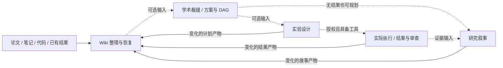

# DSH Paper Tailor · Skills

> **From Research Materials to Evidence-backed Stories**  
> 基于 [DSH Paper Tailor](https://github.com/ZyfNO2/dsh-paper-tailor) 整理的独立科研技能包：从材料与 Wiki 出发，提出方法组合、设计实验，并用已有证据组织研究故事。

**技能包优先更新，DSH 插件随后同步。** 这里先迭代 Skill 正文、文件流程与独立运行助手，成熟后再同步到 DSH 插件。两者发布节奏不同，技能包新增行为不代表插件已经接入；宿主能力以对应版本的交付和验收记录为准。

## 🎯 What is DSH Paper Tailor · Skills?

研究可以从一篇论文、一个已有目录、一份实验结果，或者尚未完整的想法开始。本包将原项目的研究流程收敛为四个独立 Skill，让 Agent 接着当前工作推进，不要求记住大量命令或从头运行整套流程。

1. **Organize：** 整理材料与 Wiki，保留原文、版本和冲突。
2. **Tailor：** 拆解基线 A 与模块 b/c，提出有依据、可验证的组合。
3. **Experiment：** 设计对比、消融与预算，关联实际运行和结果。
4. **Tell & Maintain：** 组织研究叙事，将新增实验与故事产物增量整理回 Wiki。

不需要先启动 DSH 或工作台。Agent 宿主需具备读取文件及相应工具的能力，Wiki 运行助手需要 Node.js 24+；模型与工具由宿主提供，包内不包含凭据。

## 🧭 从哪个入口开始？

| 简短意图 | 实际 Skill | 用途 | 主要交付 |
| --- | --- | --- | --- |
| `/init` | `wiki-maintain` | 有材料就整理/恢复；没有材料先确认目标与联网意愿 | Wiki、来源引用、覆盖记录、未解决问题 |
| `/tailor` | `academic-tailor` | 选择基线与模块，检查怎么接、缺什么 | `TAILOR.md`、研究任务 DAG |
| `/exp` | `experiment-design` | 设计对比、消融、指标、预算与结果记录 | `EXPERIMENT-PLAN.md`；执行获授权后关联 Run/结果 |
| `/story` | `research-story` | 将创新假设、方法差异和证据组织为主线 | `STORY-PLAN.md`、贡献—证据表与补证清单 |

短名称是使用约定，**不表示所有宿主已注册同名斜杠命令**。宿主未识别或 `/init` 与内置命令冲突时，使用实际 Skill 名称或自然语言调用。

**软依赖，不设强制阶段门禁。** 可以没有 Wiki 直接裁缝、设计后先讲故事，也可以带已有结果直接进入实验阶段。没有总 Skill，也没有单独的创新点 Skill；创新假设与方法组合由学术裁缝负责。实验所需的数据、环境和资源仍需实际具备。

### 三个最短使用示例

**整理或恢复已有研究**

```text
用 wiki-maintain 整理这个目录；先盘点全部材料，复用已有 Wiki，
只更新变化和未完成部分，保留来源、人工笔记与待核实项。
```

**提出方案，先看故事**

```text
用 academic-tailor 基于这些材料提出方法组合，给出方案与任务 DAG。
先不运行实验；再用 research-story 看看这个设计能怎样组织研究主线，
所有尚未验证的贡献保留为假设。
```

**设计实验或带回结果**

```text
用 experiment-design 接着这个方案做对比和消融计划，先不启动训练。
已有结果可以直接核对并复用。保存本轮产物后，增量维护 Wiki。
```

实验和故事产物保存后，默认增量维护当前工作区 Wiki，只处理变化产物及受影响页面。用户可明确跳过；工具不可用或同步失败时报告待同步，不把局部完成说成全部成功。维护不会反过来启动新一轮实验或故事。

## 🧩 Core Features

| 能力 | 用户体验 | 保留的边界 |
| --- | --- | --- |
| Evidence Wiki | 阅读自然正文，展开查看原文与版本 | 字节匹配不等于语义支持；目录覆盖与提交成功分别记录 |
| Academic Tailoring | 看清 A+b+c 的来源、接入位置与代价 | 概念兼容、接口核验、样本跑通分别记录；组合不保证创新或收益 |
| Experiment Design | 对比与消融回答具体问题 | 指标口径、资源估算、退化约束、失败和全部尝试不隐藏 |
| Research Story | 将问题、方法、证据与局限串起来 | 没有结果也能规划故事，不能写成已取得效果 |
| Incremental Maintenance | 实验与故事的新材料回流 Wiki | 计划、历史报告、本轮真实结果、模拟和假设分开 |
| File-based Continuation | 换会话后读取文件继续 | 原始来源、产物与 trace 决定状态，界面不制造第二套事实 |

### Team · 占位 / Planned

**Team 是后续可选执行扩展，当前独立技能包不交付完整 Team 调度系统。** 计划用于承接研究 DAG 中可并行的任务，展示成员职责、任务依赖、运行状态和产物。

目前可由用户或具备工具的单 Agent 执行已授权实验；没有 Team 不阻塞四个 Skill。原 DSH 项目的 Team 展示与历史实现，不等于本包已接入原生成员、派发、暂停、重试或独立 Reviewer。不会把建议角色显示成正在工作的成员。

## 🏗 Architecture



图中回流是文件维护，不是自动循环研究。四个 Skill 均可独立接收材料。知识图谱表达知识关系，任务 DAG 表达工作依赖，二者不能混用。

| 路径 | 职责 |
| --- | --- |
| `trial-skills/wiki-maintain/` | Wiki 指令、引用与合并规则、文件运行助手 |
| `trial-skills/academic-tailor/` | 裁缝方案、核验表与任务 DAG |
| `trial-skills/experiment-design/` | 实验计划、交接与维护要求 |
| `trial-skills/research-story/` | 研究主线、贡献证据与维护要求 |
| `install-independent.mjs` | 将四个独立 Skill 安装到指定工作区 |
| `research-intent.mjs`、[ENTRYPOINTS.md](ENTRYPOINTS.md) | 四个短意图的本地只读交接；保留宿主内置 `/init`，不冒充原生菜单注册 |

工作台作为展示层推进；静态参考原型不等于已完成的 WeKnora 源码剪枝。完整图谱、DAG 白板与 Team 界面仍需设计和接线，见 [UI 设计需求](../planning/2026-10-25/ui-design-handoff/UI-DESIGN-BRIEF.md)。

## 🚀 Quick Start

获取仓库或解压独立分发包。在包含 `install-independent.mjs` 的目录运行，目标工作区需已存在：

```powershell
# 预览安装内容
node install-independent.mjs --workspace "F:\my-research"

# 安装四个独立 Skill
node install-independent.mjs --workspace "F:\my-research" --write
```

安装位置为工作区下的 `.agents/skills/`。安装器不改全局配置、不写模型凭据，遇到同名目录会拒绝覆盖；更新已有安装前保留本地修改，按宿主支持的更新方式处理。目录发现与斜杠命令支持以实际宿主为准。

也可将需要的 Skill 目录导入宿主，或要求 Agent 读取对应 `SKILL.md`，保留配套 references 与 scripts。Wiki 内部运行方式见 [RUNTIME.md](trial-skills/wiki-maintain/RUNTIME.md)，日常使用无需逐条调用内部命令。

旧 `install.mjs` 与根 `SKILL.md` 属于历史单总 Skill 路径，不是本版安装入口。旧 README 已归档为 [历史说明](../planning/2026-10-26/RESEARCH-PACK-README-LEGACY.md)。

## 📍 Status & Roadmap

截至 2026-10-26，v7 将 v6 的 Skill 约定接入指定范围覆盖与实际产物回流。它不自动拦截任意宿主保存事件；当前 Agent 保存产物后调用文件助手，语义编译仍由 Agent 完成。

| 项目 | 状态 |
| --- | --- |
| 四个独立 Skill、软依赖编排 | 已提供 |
| Wiki 文件运行助手、引用/快照/恢复测试 | 已有实现与工程测试 |
| 实验、故事后增量维护 Wiki | 文件助手 feedback → Agent 合并 → apply；本轮实际计划/叙事产物回流与重复无漂移已验；不运行实验 |
| 全范围覆盖对账的程序强制检查 | requestScope、版本绑定阅读证明、跨请求未读待办已实现；字节对账不是语义证明 |
| 短意图入口、读取适配 | 本地 research-intent 可用，真实 DSH filesystem provider 发现四 Skill 已验；原生 slash 未注册 |
| 只读 Wiki reader | 原 WK Vue/TDesign reader/version 裁剪接线，验证记录随工程交付；不是完整工作台 |
| 知识图谱与 DAG 白板 | 仍为设计/接线阶段 |
| Team | 占位，后续可选扩展 |
| DSH 插件同步 | 后于技能包更新，独立验收与发布 |

35 项文件/分发/入口工程测试通过，另有 reader 专项验证；三份真实 Markdown 在隔离工作区完成 Agent 整理、维护说明增量与计划/叙事文件回流。它们不保证每次模型输出正确，不证明材料报告的实验已由本轮复现；真实完整 DSH 活会话、跨宿主菜单与 PDF/OCR 仍须分别验收。安装技能包不自动授权真实训练、GPU 作业或论文改写。

## 🔗 References

- [DSH Paper Tailor](https://github.com/ZyfNO2/dsh-paper-tailor)：本技能包的项目来源。
- [WeKnora](https://github.com/Tencent/WeKnora)：Wiki 候选、引用、合并及阅读机制的参考；本包不是其完整部署。
- [四 Skill 编排与工程边界](../planning/2026-10-26/SOFT-SKILL-FLOW.md)。
- 各 Skill 的 `references/` 保留课程、论文与工程参考的采用边界，不把参考方法当已验证研究收益。
